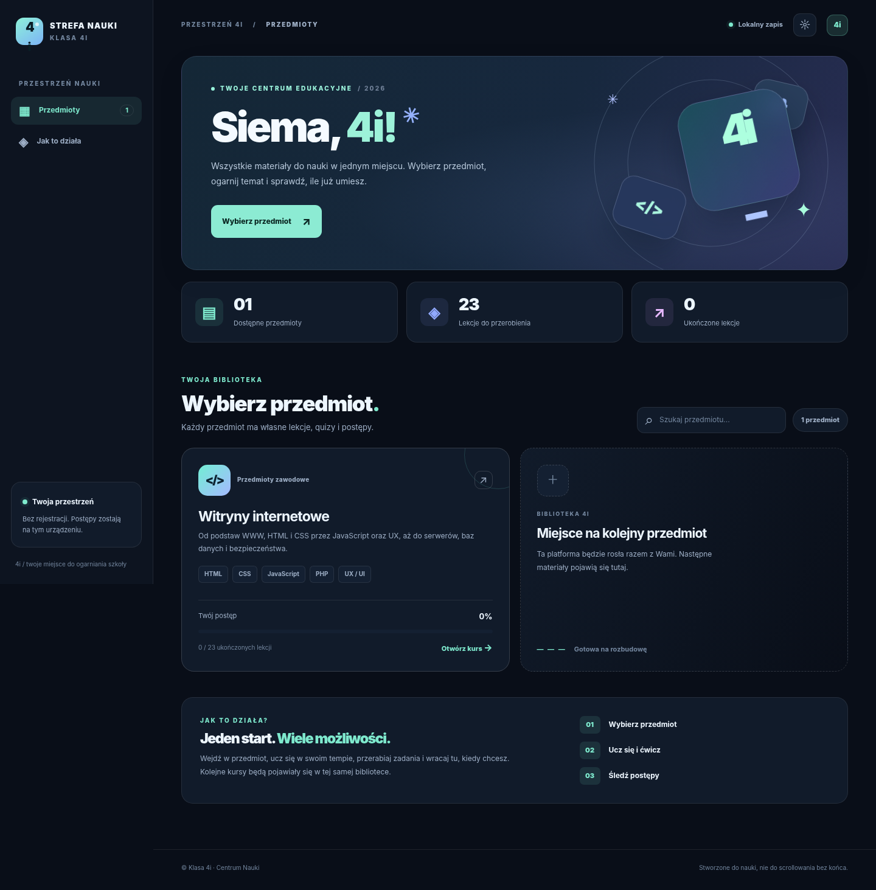

# Klasa 4i — Centrum Nauki



Platforma edukacyjna klasy **4i**, rozwijana tak, żeby dodawać kolejne przedmioty. **Na razie jest tylko jeden: Witryny internetowe**. Po wejściu na stronę uczniowie najpierw widzą katalog przedmiotów, a po kliknięciu przechodzą do osobnego kursu. Bez backendu, frameworków i budowania projektu — idealne do **GitHub Pages**.

## Co jest dostępne

- **Strona główna** `index.html`: wybór przedmiotu, wyszukiwarka przedmiotów, statystyki i postęp.
- **Witryny internetowe**: dotychczasowy pełny kurs — 23 lekcje, 57 fiszek, 66 pytań, quiz, egzamin, 8 laboratoriów HTML/CSS/JS, słownik, notatki, historia wyników i postępy.
- Motyw ciemny i jasny, responsywność, obsługa klawiatury, PWA i podstawowe działanie offline po zapisaniu zasobów.
- Każdy przedmiot ma **osobną podstronę**, a jego postępy są przechowywane w osobnym kluczu `localStorage`. Obecny kurs nadal korzysta z `witryny-lab-v1`, żeby zachować wcześniejsze dane na tej samej domenie.

## Jak uruchomić

1. Otwórz główny `index.html` w przeglądarce lub uruchom `python -m http.server 8000` w katalogu repozytorium.
2. Otwórz `http://localhost:8000/`.
3. Wybierz **Witryny internetowe**. Z każdego miejsca w kursie możesz wrócić do strony głównej przez **Wszystkie przedmioty**.

**GitHub Pages:** prześlij całą zawartość projektu do repozytorium, tak żeby plik `index.html` leżał w katalogu głównym. W **Settings → Pages → Build and deployment** wybierz **Deploy from a branch**, `main`, `/(root)`. Strona będzie dostępna zwykle pod `https://LOGIN.github.io/REPO/`. Ścieżki są względne, więc działają także pod podkatalogiem repozytorium.

## Struktura plików

```text
klasa-4i/
├── index.html                         # główna strona / wybór przedmiotu
├── css/
│   └── portal.css                     # style głównej strony
├── js/
│   └── portal.js                      # działanie katalogu przedmiotów
├── subjects/
│   ├── catalog.js                     # CENTRALNY SPIS PRZEDMIOTÓW
│   └── witryny/
│       ├── index.html                 # osobna aplikacja Witryny
│       ├── css/
│       │   ├── styles.css
│       │   └── extra.css
│       └── js/
│           ├── data.js               # teoria, fiszki, pytania
│           ├── labs.js               # edytor kodu i ćwiczenia
│           ├── app.js                # quizy, nawigacja, postępy
│           └── pwa.js
├── assets/                            # ikony PWA
├── manifest.webmanifest
├── sw.js                               # offline/cache całej platformy
├── tests/
└── README.md
```

## Dodawanie nowego przedmiotu

Nie trzeba zmieniać HTML ani CSS strony głównej. Robisz to w **2 krokach**:

**Krok 1.** Utwórz katalog, np. `subjects/matematyka/`, a w nim plik `index.html` (i własne `css/`, `js/`, jeśli potrzebujesz). To może być osobna strona lub kopia istniejącego silnika Witryn ze zmienionymi treściami.

**Krok 2.** Dodaj wpis w `subjects/catalog.js`:

```js
{
  id: 'matematyka',
  name: 'Matematyka',
  shortName: 'Matma',
  category: 'Przedmioty ogólne',
  description: 'Zadania, powtórki i sprawdziany.',
  href: 'subjects/matematyka/',
  icon: '∑',
  color: 'mint',
  tags: ['Funkcje', 'Równania'],
  lessons: 12,
  flashcards: 30,
  quizzes: 40,
  labs: 0,
  storageKey: 'klasa4i-matematyka-v1'
}
```

Wstaw obiekt do tablicy `window.CLASS4I_SUBJECTS`, **po przecinku**, obok `witryny`. Nowy przedmiot sam pojawi się na stronie głównej i będzie uwzględniany w liczniku. Dodanie danych kursu i jego działania jest osobnym zadaniem — wpis w katalogu sam nie tworzy lekcji ani quizów.

**Postęp na stronie głównej:** skrypt `js/portal.js` liczy ukończone lekcje na podstawie obiektu `completed` w kluczu `storageKey`. Jeśli kolejny kurs użyje innego formatu, dodaj dla niego odpowiedni adapter w `getDone()`.

**Offline dla przyszłych przedmiotów:** aby kolejne kursy działały offline już po pierwszym odwiedzeniu strony głównej, wpisz ich zasoby do `CORE` w `sw.js` i zmień `CACHE_NAME`. Bez tego zasoby wciąż mogą być zapisane po pierwszym otwarciu kursu przy aktywnym service workerze.

## Przechowywanie danych

Postępy, notatki, zapisane kody z laboratorium i motyw są lokalne, w danej przeglądarce. Nie ma wspólnej bazy wyników całej klasy, logowania ani synchronizacji pomiędzy urządzeniami. W kursie Witryny możesz eksportować/importować postępy jako JSON. Nie przesyłaj tych danych do repozytorium.

## Uwaga do testów

Do ręcznego testowania uruchom `python -m http.server 8000`. Test automatyczny Playwright znajduje się w `tests/smoke.py` (wymaga modułu `playwright` i przeglądarki Chromium).

Materiały kursu Witryny opierają się na przesłanym pliku `witryny_ai.pdf`.

## Gotowy szablon do przyszłych przedmiotów

Nie musisz kopiować rozbudowanego kursu Witryn. W repozytorium jest **`templates/nowy-przedmiot/`** — prosta, uniwersalna baza przyszłych kursów, korzystająca ze współdzielonego silnika `js/course-template.js` i styli `css/course-template.css`.

1. Skopiuj **zawartość** `templates/nowy-przedmiot/` do np. `subjects/matematyka/`.
2. W `subjects/matematyka/data.js` zmień `id`, `title`, `subtitle`, `storageKey` i uzupełnij tablice `modules`, `lessons`, `flashcards`, `questions` własnymi treściami. Usuń demonstracyjne pytania.
3. Dopisz przedmiot do `subjects/catalog.js`. Upewnij się, że `href`, `lessons` i `storageKey` odpowiadają rzeczywistemu folderowi i danym.
4. Prześlij zmiany na GitHuba. Kafelek pojawi się na stronie głównej automatycznie.

Szablon obsługuje: **lekcje z sekcjami, odhaczanie ukończenia, własne notatki, fiszki, quiz z wyjaśnieniami, pasek postępu i jasny/ciemny motyw**. Może być bazą do dalszych funkcji specyficznych dla przedmiotu. Sam szablon nie jest dodatkowym przedmiotem i nie pojawia się na stronie głównej. Katalog zawiera obecnie wyłącznie Witryny internetowe.
